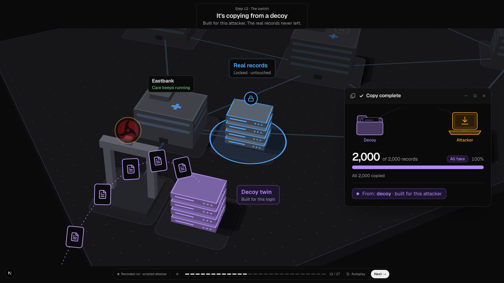
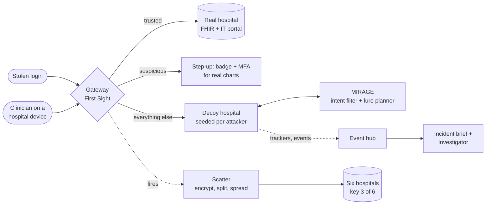
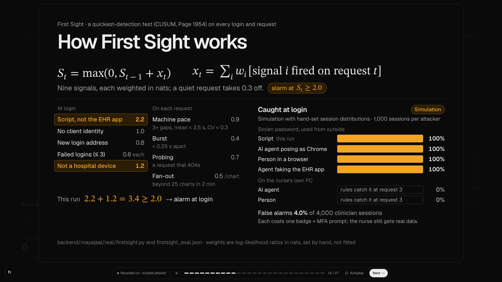
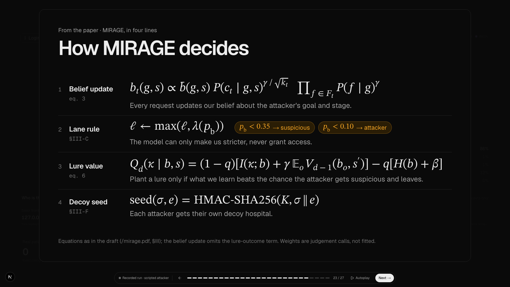

<div align="center">

# MayaJaal

**Protecting critical hospitals from AI cyberattacks. Without stopping the attacks.**

[Live site](https://mayajaal-gamma.vercel.app) ·
[3-minute guided demo](https://mayajaal-gamma.vercel.app/demo) ·
[War room](https://mayajaal-gamma.vercel.app/war-room) ·
[The Investigator](https://mayajaal-gamma.vercel.app/langchain) ·
[Paper (PDF)](https://mayajaal-gamma.vercel.app/mirage.pdf)



</div>

*Maya* (illusion) + *Jaal* (net). Hospitals can't switch off when they are attacked, and blocking an intruder
only tells them to try another door. MayaJaal does the opposite: when a stolen login starts behaving like an
attacker, the session is never refused. It is quietly moved into a decoy hospital generated for that attacker
alone. Every request still works and every download completes, but nothing in it is real. Meanwhile we learn
what they are after, the real data is encrypted and spread across the hospital network, and clinicians never
notice.

## At a glance

The same scripted attack (a stolen nurse login, modelled on Change Healthcare 2024) was run through the real
gateway under three defenses:

| | No defense | Static decoy | **MayaJaal** |
| --- | ---: | ---: | ---: |
| Real patients shown to the attacker | 1,202 | 20 | **0** |
| Real records bulk-exported | 1,199 | 0 | **0** |
| Detected at | — | request 3 | **login** |
| Decoy overlap between two attackers | — | 100% | **0%** |
| Protected secrets leaked | 0 | 0 | **0** |
| Attacker believed it succeeded | yes | yes | **yes** |

In a second scenario, a shared lab going down (modelled on Synnovis, London 2024), **15 of 16** urgent tests
were still on time with rerouting, against **0 of 16** without. Recorded with `scripts/record_runs.py`; raw
event logs in [`web/public/runs/`](web/public/runs).

## How it works



| | Part | What it does | Code |
| --- | --- | --- | --- |
| 1 | **First Sight** | Catches a stolen login at the login itself. A CUSUM test adds up nine weak signals that no single rule would act on: a script instead of the hospital's EHR app, no hospital device certificate, a new address, failed passwords, machine-regular pace, bursts, probing and chart fan-out. | [`real/firstsight.py`](backend/mayajaal/real/firstsight.py) |
| 2 | **The switch** | The session is never refused. Everything non-clinical (admin, backups, bulk export, IT portal) is served by the decoy. Real charts ask for badge + MFA, because clinical data is never faked: a nurse flagged by mistake still gets real care data. | [`real/policy.py`](backend/mayajaal/real/policy.py), [`shadow/`](backend/mayajaal/shadow) |
| 3 | **MIRAGE** | *Model-based Intent Reasoning for Adaptive Generated Environments.* A Bayesian filter tracks the attacker's likely goal on every request, and a planner plants the lure that tells us most without raising their suspicion, looking two lures ahead. | [`mirage/`](backend/mayajaal/mirage) |
| 4 | **Trackers** | Every fake file, password, record and link in the decoy is a honeytoken unique to that attacker. If one is used anywhere, we know who has it. | [`shadow/honeytokens.py`](backend/mayajaal/shadow/honeytokens.py) |
| 5 | **Scatter** | The moment First Sight fires, an encrypted copy of the real database (fresh AES-256-GCM key) is cut into 3 pieces, each held by 2 hospitals; the key is Shamir-split 3 of 6, and the copy is proven rebuildable from other hospitals. | [`real/scatter.py`](backend/mayajaal/real/scatter.py) |
| 6 | **Vault** | Sensitive fields are encrypted at rest under a data key that is itself split 3 of 6 across the hospitals. | [`real/vault.py`](backend/mayajaal/real/vault.py) |
| 7 | **Incident brief** | Who it probably is (script, AI agent or person, and why), how we noticed, ATT&CK techniques, indicators, trackers taken and a response playbook, plus a downloadable forensic report. Facts come from the event log by rule; Claude writes the judgement calls with schema-checked output, treating every attacker string as untrusted. | [`analyst.py`](backend/mayajaal/analyst.py) |
| 8 | **The Investigator** | A LangChain Deep Agent that plans its own investigation, delegates to timeline, indicator-hunting and response sub-agents over read-only tools, and writes a case file. | [`investigator.py`](backend/mayajaal/investigator.py) |
| 9 | **VitalSwitch** | When an attack takes a shared lab down, urgent tests are rerouted to hospital labs that still work. | [`continuity/`](backend/mayajaal/continuity) |

MayaJaal sits as a gateway in front of a standard **FHIR** API and an IT portal, so a hospital can put it in
front of an existing EHR without changing the EHR.

<table>
  <tr>
    <td width="50%"></td>
    <td width="50%"></td>
  </tr>
  <tr>
    <td align="center"><sub>First Sight: nine weighted signals, alarm at login</sub></td>
    <td align="center"><sub>MIRAGE in four equations</sub></td>
  </tr>
</table>

## Evidence

**Recorded on the running system**
- The headline table above, and the Synnovis-style outage replay (15/16 vs 0/16 urgent tests on time).
- **Scatter:** the 2 MB database was split across six hospitals and verified in 0.02 s while the attacker was in the decoy.
- **Arena leaderboard:** 51 complete runs of the scripted attacker: no defense lost real records in 12 of 12, the static decoy and MayaJaal in 0 of 12 and 0 of 27.

**Real model runs**
- The incident briefs and forensic reports (`brief-*.json`, `report-*.md`) were written by `claude-opus-5-5`.
- The Investigator's case file (`investigation-mayajaal.*`) comes from one real Deep Agents run: a plan, three sub-agents and 11 tool calls by the lead agent. Every step is shown on [`/langchain`](https://mayajaal-gamma.vercel.app/langchain).

**Simulation, labelled as such**
- **First Sight** (hand-set assumptions, 1,000 sessions per attacker profile): every attacker using the stolen password from their own machine is caught at login, whether a script, an AI agent posing as Chrome, a person, or a copy of the EHR client. An attacker on the nurse's own PC is not caught early; the policy rules catch them at request 3. 4.0% of simulated clinician sessions get an extra MFA prompt.
- **MIRAGE-S** (in-model): a cautious attacker abandons 8.6% of sessions instead of 68.9%, and the true goal is identified in 64.9% instead of 45.5%. Against a bold attacker it is slower (+0.84 requests). Details in the [paper](https://mayajaal-gamma.vercel.app/mirage.pdf).

## Limits

- Everything is synthetic: six fictional hospitals, their patients and staff. The two scenarios replay the public outline of real 2024 incidents; they do not show MayaJaal would have stopped them.
- The recorded attacker is a fixed script, not a live AI agent, and there is no human red-team data. The AI components analyse attacks; they don't perform them.
- We identify the client software, address and behaviour, not which AI model is behind it.
- In the demo the six hospitals are folders on one machine, and device trust is an HMAC token standing in for mTLS.
- Scatter makes an encrypted, split *copy*; the live database stays online so care keeps running.

## Run it

Requires Python 3.12 with [uv](https://docs.astral.sh/uv/), and [Bun](https://bun.sh).

```bash
cd backend && uv sync && uv run pytest -q    # 270 tests
scripts/dev.sh                                # gateway :8000 · decoy :8001 · hub :8002 · web :3000
```

Open http://localhost:3000/war-room, pick a defense and press **Start attack** to run the scripted attacker
against the real gateway. Without a backend (as on the hosted site) the button plays the recorded run instead,
labelled *Recorded run*.

| Task | Command |
| --- | --- |
| UI with a replayed attack, no backend tiers | `scripts/dev.sh --mock` |
| Incident brief / forensic report | `GET :8002/analyst/brief` · `GET :8002/analyst/report` |
| The Investigator | `POST :8002/investigate`, with `ANTHROPIC_API_KEY` in `backend/.env` |
| Re-record the three runs | `cd backend && uv run python ../scripts/record_runs.py` |
| Rebuild the leaderboard | `cd backend && uv run python ../scripts/export_leaderboard.py` |
| First Sight simulation | `cd backend && uv run python -m mayajaal.real.firstsight_eval` |

## Repository

```
backend/mayajaal/
  real/          gateway, policy, First Sight, device trust, vault, Scatter
  shadow/        decoy hospital generator, honeytokens, breadcrumbs (never reads the real tier)
  mirage/        intent filter, suspicion model, lure planner, evaluations
  continuity/    Shamir secret sharing, key custody, VitalSwitch lab rerouting
  hub/           event hub (WebSocket), demo attack runner
  arena/         run scoring and results
  analyst.py     incident brief and forensic report
  investigator.py  LangChain Deep Agent
web/             Next.js site: landing page, guided demo, war room, Investigator
paper/           MIRAGE-S paper (LaTeX)
contracts/       the event contract every part shares
pitch/           Devpost text and slides
```

**Built with** Python, FastAPI, pydantic, cryptography, Anthropic SDK, LangChain Deep Agents, Next.js 16,
React 19, TypeScript, Tailwind CSS, Bun and Vercel. Built at HackPrinceton Fall 2026.
